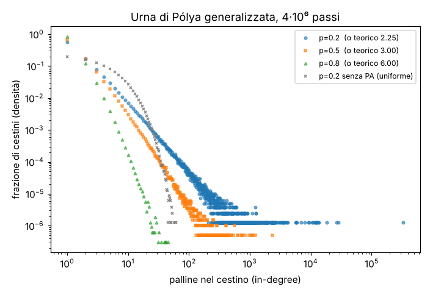

# Capitolo 03: Social Networks

**Lezione:** SD-03 (1:16:12), Dott.ssa Ida Mele, IASI-CNR
**Slide:** `3_Social_Networks_SDA25.pdf` (50 pagine). La versione SDA26 su Teams è identica salvo tre ritocchi (sez. 2 e file divergenze).
**Riferimento:** capitolo 2, *Networks: The How of Social Media*, del libro [1] *Social Media Data Mining and Analytics* (Szabo, Polatkan, Boykin, Chalkiopoulos, Wiley 2019), pp. 41-76
**Fonti 2026:** nessuna integrazione Teams per questo capitolo.
**Codice:** la lezione non ha notebook. Tutti i blocchi del capitolo sono note aggiunte o porting del libro, eseguiti con `verifica_sd03.py` (output in `verifica_sd03_output.txt`, figura `polya_powerlaw.png`).

## Indice

1. [Perché le reti sociali contano](#1-perché-le-reti-sociali-contano)
2. [Tipi di reti](#2-tipi-di-reti)
3. [Grafi: diretti, non diretti, grado](#3-grafi-diretti-non-diretti-grado)
4. [Proprietà di nodi e archi, grafi pesati](#4-proprietà-di-nodi-e-archi-grafi-pesati)
5. [Completezza e legge di Metcalfe](#5-completezza-e-legge-di-metcalfe)
6. [Campionare e visualizzare una rete: snowball sampling](#6-campionare-e-visualizzare-una-rete-snowball-sampling)
7. [Distribuzione dei gradi: Wikipedia e X](#7-distribuzione-dei-gradi-wikipedia-e-x)
8. [Clustering, rewiring e chiusura dei triangoli](#8-clustering-rewiring-e-chiusura-dei-triangoli)
9. [Assortatività e omofilia](#9-assortatività-e-omofilia)
10. [Reti complesse e small world](#10-reti-complesse-e-small-world)
11. [Modellare la crescita di una rete: preferential attachment e urna di Pólya](#11-modellare-la-crescita-di-una-rete-preferential-attachment-e-urna-di-pólya)
12. [Riepilogo e compiti](#12-riepilogo-e-compiti)

---

## 1. Perché le reti sociali contano

*SD-03 @ 00:00:10*

> **Nota aggiunta (sulla registrazione):** il video si apre con 10 secondi di schermata del corso senza audio e la docente comincia a metà discorso ("Vi stavo accennando..."), già sulla slide 3. Le slide 1 (titolo) e 2 (*Outline*) non compaiono. L'outline elenca: tipi di reti; rappresentazione a grafo (diretti e non diretti, in/out-degree, proprietà, pesi, completezza); analisi (esempi da Wikipedia, X, LiveJournal; campionamento e visualizzazione; clustering e assortatività); modellazione delle reti.

I tre ingredienti delle piattaforme sociali sono gli utenti, il contenuto che condividono (testo, immagini, video) e le **connessioni** fra utenti: la *social network*. Quasi ogni servizio web permette oggi di collegarsi ad altri utenti, per interessi comuni, per amicizia o per relazioni professionali; alcune reti riflettono anche gerarchie organizzative.

La rete funziona come un **filtro**: se seguo qualcuno su Instagram o su X, vedo i post e le foto di chi seguo e non vengo "inondata" da quelli di estranei. Accanto a questi compare contenuto di persone che non seguo, per esempio sponsorizzato (SD-03 @ 00:01:22).

Per lo stesso motivo la rete è una fonte d'informazione preziosa per il data analyst: la struttura della rete intorno a un utente è un segnale delle sue preferenze e della sua cerchia sociale. Serve a migliorare gli algoritmi di raccomandazione (SD-03 @ 00:02:00):

- di **contenuti**: news, articoli, blog, immagini, video, anche sponsorizzati;
- di **persone** da seguire: con interessi in comune o che l'utente probabilmente conosce, come un collega.

Il libro chiama questo effetto *guided serendipity*: "serendipity" è scoprire qualcosa per caso, ma qui la scoperta è guidata dagli algoritmi che hanno profilato abitudini e interessi (SD-03 @ 00:02:35). Il risultato è più *user engagement*: l'utente usa di più la piattaforma, la piattaforma diventa più popolare, chi la possiede vende più annunci. La slide aggiunge l'altro effetto: più utenti collegati rendono la rete più densa e quindi il servizio più popolare.

### Come nascono le reti

*SD-03 @ 00:03:51*

Nessuna rete sociale è nata come la conosciamo oggi. All'inizio ci sono pochi utenti, i fondatori e qualche amico o conoscente; i milioni di iscritti arrivano dopo.

- **Facebook** parte come rete fra gli studenti di Harvard; Mele cita *Facemash* come nome originario, poi il servizio si estende agli Stati Uniti e al resto del mondo.
- **Twitter** nasce come servizio di microblogging via SMS, per mandare un unico messaggio a un gruppo di amici; poi diventa un servizio online, si diffonde fra cantanti e personaggi popolari americani, e oggi si chiama X (SD-03 @ 00:04:42).

> **Nota aggiunta (verificata su Wikipedia, *History of Facebook*):** Facemash (2003) era un sito di Zuckerberg che confrontava a coppie le foto degli studenti di Harvard prese dagli annuari online, chiuso dall'università dopo pochi giorni. Facebook è stato lanciato il 4 febbraio 2004 come "TheFacebook" e rinominato nel 2005. Facemash è quindi un precursore, non lo stesso servizio con un altro nome. La slide è più cauta: "Facebook started as a website gathering photos of Harvard students (Facemash)".

All'inizio c'è un'**aria di esclusività**: si entra solo su invito di un utente già iscritto. Questo rallenta la crescita, ma i primi utenti, gli **early adopter**, sono attivi, creano molte connessioni e formano il **core network**, il nucleo centrale. Più il nucleo è affiatato, più sosterrà lo sviluppo futuro della rete (SD-03 @ 00:05:17).

---

## 2. Tipi di reti

*SD-03 @ 00:05:52*

| Distinzione | Primo tipo | Secondo tipo |
|---|---|---|
| **Offline / online** | connessioni nel mondo reale: amici, colleghi; reti per tracciare malattie (animali per la "mucca pazza", persone durante il COVID) | connessioni via web, nate con il Web 2.0: social network (Facebook, X, Instagram, LinkedIn), content sharing (Flickr, YouTube, SlideShare), creazione di contenuti (Wikipedia), forum (Quora, Yahoo! Answers), giochi online |
| **Mondo reale / interessi** | riflettono connessioni sociali esistenti, come faccia a faccia, telefono, email (Facebook, LinkedIn) | nascono dalla condivisione di contenuti fra persone che spesso non si sono mai incontrate (Flickr, YouTube) |
| **Private / pubbliche** | la connessione richiede il consenso di entrambi (Facebook) | chi segue agisce da solo, chi è seguito non deve autorizzare (X, Instagram; eccezione: profili privati) |
| **Esplicite / implicite** | connessioni create volontariamente: follow, amicizia, contatto professionale | connessioni create dalle **azioni**: commenti, modifiche, messaggi |

Gli esempi della lezione:

- Nelle reti basate sugli interessi, su Flickr si collegano appassionati di fotografia e viaggi che commentano le foto altrui, anche di paesi e lingue diversi; su YouTube le guru del make-up sono seguite soprattutto da ragazze, mentre chi spiega come aggiustare un tubo o una tapparella è seguito da chi si occupa della casa (SD-03 @ 00:09:01).
- Nella rete privata, finché la richiesta di amicizia non è accettata vedo solo immagine del profilo e username; dopo vedo interessi, dati personali, amici, post e foto (SD-03 @ 00:09:36).
- Nella rete pubblica, seguire qualcuno significa esprimere la volontà di vedere ciò che pubblica: se X segue Y, X riceve costantemente gli aggiornamenti di Y. Il profilo di un'influencer è quasi sempre pubblico, anche se su Instagram i profili privati sono "sempre di più" (SD-03 @ 00:10:42).

> **Integrazione slide SDA26:** nella pagina *Online vs Offline* LinkedIn passa dalla riga dei social network a una nuova riga "Professional social networks (e.g., LinkedIn, ResearchGate)". È l'unica differenza di contenuto fra le due versioni.

### Reti esplicite e implicite

*SD-03 @ 00:11:16*

Nelle reti **esplicite** l'utente compie un'azione esplicita: segue qualcuno su X, chiede l'amicizia su Facebook e attende la conferma, segue un collega su LinkedIn. Nelle reti **implicite** il legame nasce da un'azione: un utente pubblica un video su YouTube, un altro lo commenta, e fra i due si crea un link (SD-03 @ 00:12:05).

Per il data analyst le reti implicite sono **più interessanti** delle esplicite: analizzandole si predicono gli interessi degli utenti e si migliorano le raccomandazioni di contenuti e di persone, sempre per aumentare l'engagement (SD-03 @ 00:12:45). Due usi:

- **Link prediction** (SD-03 @ 00:13:18): scoprire relazioni che gli utenti non hanno ancora creato. Due persone magari si conoscono ma non si sono ancora trovate: suggerisco l'amicizia su Facebook o il follow su X e Instagram, e grazie alla raccomandazione il link si crea. La slide aggiunge che serve anche per raccomandare contenuti.
- **Collaborative filtering** (SD-03 @ 00:13:48): analizzo le azioni di un gruppo di utenti per predire quelle di un utente target e raccomandargli contenuti (articoli, notizie, tweet, immagini) o prodotti. La connessione è fra due tipi diversi di entità, utenti e item. È molto usato nell'e-commerce, per esempio su Amazon.

Il collaborative filtering aiuta con il **cold start** (SD-03 @ 00:14:23): un utente nuovo non ha storico, ma so quale prodotto sta guardando. Se molti utenti che hanno comprato una padella wok hanno poi comprato una vaporiera, mostro la vaporiera a chi guarda il wok; se chi compra i guanti compra anche la sciarpa, mostro le sciarpe a chi sta comprando i guanti (SD-03 @ 00:14:53).

### La rete implicita di Wikipedia

*SD-03 @ 00:15:26*

L'esempio di rete implicita usato nel resto della lezione è la rete degli editori di Wikipedia. Wikipedia offre a ogni utente una **user talk page**, una pagina wiki che appartiene a quell'utente e su cui gli altri lasciano messaggi o discutono, "come in una sorta di chat". Quando un utente scrive sulla talk page di un altro, si crea un arco fra i due.

I dati sono **un mese** di attività. Per ogni coppia si registrano autore del messaggio, destinatario e numero di messaggi nella finestra: ne risulta una rete **diretta e pesata** (SD-03 @ 00:16:48).

Come per la *user activity* (capitolo 02), molte modifiche sono di **bot**. Si eliminano togliendo gli utenti con "bot" nel nome: un metodo "semplice e brutale" ma efficace, che lascia le sole interazioni fra umani.

> **Nota aggiunta (dal libro, Listing 2.1, pp. 49-51):** le talk page sono nel *namespace* 3 di Wikipedia. Il filtro del libro è la regex `.*[Bb][Oo][Tt]\b` (un nome che contiene una parola terminante in "bot"), applicata sia all'autore sia al destinatario; si scartano anche le auto-modifiche. Il libro ammette che non è infallibile. Il periodo è gennaio 2013 e la rete risultante ha circa 100.000 utenti e 136.000 archi diretti.

---

## 3. Grafi: diretti, non diretti, grado

*SD-03 @ 00:17:34*

Una rete sociale ha due ingredienti, utenti e connessioni, e il modello naturale è il **grafo**: i nodi sono gli utenti, gli archi le relazioni (amicizia, interazione, a seconda dei dati).

Analizzare un grafo significa analizzare una **snapshot**, una fotografia in un istante. Le reti invece evolvono di continuo: utenti che entrano ed escono (nodi aggiunti e rimossi), amicizie chieste e tolte (archi che cambiano). La snapshot è una semplificazione, ma al data analyst "va più che bene" per farsi un'idea dei comportamenti (SD-03 @ 00:18:11).

### Diretti e non diretti

*SD-03 @ 00:18:56*

| | Grafo diretto | Grafo non diretto |
|---|---|---|
| Archi | orientati, come "strade a senso unico" | bidirezionali |
| Relazione tipica | following/follower (X, Instagram) | amicizia (Facebook) |

Nel grafo diretto, se il nodo *x* segue il nodo *y* c'è l'arco *(x, y)*. Mele, citando il libro: *x* è la **coda** (*tail*) e *y* la **testa** (*head*) dell'arco, con la precisazione "poi dipende dalla letteratura" (SD-03 @ 00:19:37).

> **Correzione:** la convenzione della slide e della lezione (coda = origine *x*, testa = destinazione *y*) è quella standard della teoria dei grafi. Il libro però dice il contrario: "The head of the edge is where it originates, and the tail is the node it is pointing to" ([1], p. 45). L'attribuzione "seguendo il libro" è quindi sbagliata; la definizione da usare è quella della slide. Il libro inverte i termini rispetto all'uso comune: chi lo legge non si confonda.

> **Nota aggiunta:** in NetworkX un arco di `DiGraph` è la coppia `(u, v)` con `u` origine; `G.successors(u)` dà i nodi verso cui `u` punta, `G.predecessors(v)` quelli che puntano a `v`. Non c'è un attributo "head" o "tail": conta l'ordine della coppia.

### Grado, in-degree, out-degree

*SD-03 @ 00:19:59*

Il **grado** di un nodo è il numero dei suoi vicini. Nel grafo diretto si distinguono:

| | Definizione | Su X / Instagram | Nel web graph |
|---|---|---|---|
| **In-degree** | numero di archi entranti | quante persone mi seguono (*follower*) | quante pagine HTML hanno un link alla mia |
| **Out-degree** | numero di archi uscenti | quante persone seguo (*followee*) | quanti link partono dalla mia pagina |

Nell'esempio della slide il nodo rosso ha in-degree 1 e out-degree 3: su Instagram avrebbe un follower e seguirebbe tre persone (SD-03 @ 00:20:12).

L'in-degree riflette la **popolarità** del nodo: sui social identifica gli influencer (molti follower), sul web indica quanto è popolare una pagina, come in **PageRank**, e permette di alzarla nel ranking (SD-03 @ 00:20:42).

```python
# Nota aggiunta: grafo della slide "In- and Out-Degree" ricostruito dalla figura
# (etichette dei nodi arbitrarie, R = nodo rosso). Eseguito: verifica_sd03.py [1].
import networkx as nx

G = nx.DiGraph()
G.add_edges_from([
    ("A", "T"), ("A", "R"), ("A", "B"), ("B", "A"), ("B", "G"),
    ("R", "U"), ("R", "C"), ("R", "G"),
    ("T", "C"), ("U", "C"), ("U", "E"), ("U", "F"),
    ("C", "E"), ("C", "G"), ("G", "C"), ("G", "F"), ("F", "C"),
])
print(G.in_degree("R"), G.out_degree("R"))        # 1 3
print(dict(sorted(G.in_degree())))
# {'A': 1, 'B': 1, 'C': 5, 'E': 2, 'F': 2, 'G': 3, 'R': 1, 'T': 1, 'U': 1}
print(sum(d for _, d in G.in_degree()), G.number_of_edges())   # 17 17
```

Il nodo più "popolare" della figura è C, con in-degree 5. La somma degli in-degree è sempre uguale a quella degli out-degree e al numero di archi, perché ogni arco ha un'origine e una destinazione.

> **Nota aggiunta (dal libro, p. 55):** in un grafo non diretto in-degree, out-degree e grado coincidono, e in questa definizione il grafo è considerato non pesato.

---

## 4. Proprietà di nodi e archi, grafi pesati

*SD-03 @ 00:21:48*

Nodi e archi possono avere **proprietà**:

- **nodi**: account ID, nome, paese d'origine;
- **archi**: timestamp dell'ultimo messaggio di A a B, numero di volte in cui un utente ha taggato contenuti di un altro.

Le proprietà degli archi riflettono di solito qualcosa di **temporale** o la **forza** (*strength*) del legame. Le proprietà possono avere qualunque forma: scalari, variabili categoriche, vettori, immagini, insiemi di ID, impostazioni del profilo (SD-03 @ 00:22:26).

La buona pratica è tenerle **separate** dal grafo: un file con i nodi e le loro proprietà (user ID, indirizzo IP, account name...), un file con gli archi, eventuali vettori a parte, indicizzati per user ID. Così non si analizza un unico file "troppo grande, troppo pesante" (SD-03 @ 00:22:57). La slide aggiunge: se si memorizzano gli oggetti insieme al grafo, bisogna essere sicuri che siano **stabili**.

> **Nota aggiunta:** in termini di database è la normalizzazione che il libro stesso richiama (p. 46): una tabella `nodes(user_id, account_name, signup_ts, ...)` con le sole proprietà stabili e molto usate, una tabella `edges(src_id, dst_id, weight, last_ts)`, e tabelle separate per le proprietà rare o voluminose (es. vettori di interessi) con chiave `user_id`.

### Grafi pesati

*SD-03 @ 00:23:36*

Un **grafo pesato** ha un numero associato a ogni arco, diretto o non diretto. Il significato dipende dall'interpretazione:

- la **forza** del legame, per esempio quante volte due utenti hanno comunicato in una finestra temporale;
- il grado di fiducia (*degree of belief*) che un link debba esistere: nella **link prediction** il peso indica in modo probabilistico quanto è verosimile l'arco (SD-03 @ 00:24:10);
- un **tempo**, per esempio un ritardo.

**Peso = forza: il messaggio virale** (SD-03 @ 00:24:10). Il gestore della piattaforma vuole diffondere un messaggio in modo "virale". Scegliendo i destinatari a caso, molti non saranno interessati e lo troveranno fastidioso (*annoying*). Se invece gli archi pesano quanto spesso gli utenti hanno comunicato, si scelgono gli amici con più interazioni e si manda il messaggio solo a quella porzione del grafo: il risultato è migliore perché i destinatari, scelti con un'analisi del grafo, lo troveranno verosimilmente interessante.

**Peso = tempo: il ritardo di un messaggio** (SD-03 @ 00:25:12). Nella figura (Figura 2.1 del libro) la sorgente S vuole raggiungere la destinazione D; il peso di ogni arco è il tempo che un nodo impiega a inoltrare il messaggio al successivo. Gli archi tratteggiati S→N1 e N2→N3 hanno peso **infinito**: il link non esiste. I percorsi letti a lezione sono 15 + 20 + 30, 8 + 30 e 10 + 14, e il migliore ha ritardo **24** (SD-03 @ 00:26:15).

```python
# Nota aggiunta: verifica dell'esempio con Dijkstra (il libro cita Dijkstra, p. 47).
# Eseguito: verifica_sd03.py [3].
import math, networkx as nx

W = nx.DiGraph()
W.add_weighted_edges_from([
    ("S", "A", 15), ("A", "N2", 20), ("S", "N2", 8), ("N2", "D", 30),
    ("S", "N3", 10), ("N3", "D", 14), ("N1", "N3", 6),
    ("S", "N1", math.inf), ("N2", "N3", math.inf),   # archi "assenti"
])
for path in nx.all_simple_paths(W, "S", "D"):
    print(" -> ".join(path), sum(W[a][b]["weight"] for a, b in zip(path, path[1:])))
# S -> A -> N2 -> D 65
# S -> A -> N2 -> N3 -> D inf
# S -> N2 -> D 38
# S -> N2 -> N3 -> D inf
# S -> N3 -> D 24
# S -> N1 -> N3 -> D inf
print(nx.dijkstra_path(W, "S", "D"), nx.dijkstra_path_length(W, "S", "D"))
# ['S', 'N3', 'D'] 24
```

Il nodo senza etichetta in alto nella figura è chiamato qui `A`. I totali dei tre percorsi finiti sono 65, 38 e 24: il minimo è 24, come in slide.

---

## 5. Completezza e legge di Metcalfe

*SD-03 @ 00:26:51*

**Ogni grafo si può vedere come completo e pesato**: agli archi che non esistono si assegna peso **0** se il peso è una verosimiglianza o una frequenza (l'arco "non è presente"), **infinito** se il peso è un tempo o un ritardo, come nell'esempio precedente (SD-03 @ 00:27:36).

In un grafo **completo** ogni arco possibile è presente. Per un grafo non diretto con *N* nodi il numero totale di archi è il numero di coppie di nodi:

$$L = \binom{N}{2} = \frac{N(N-1)}{2}$$

Esempi della slide: *N* = 3 dà 3·2/2 = **3** archi, *N* = 4 dà 4·3/2 = **6** (SD-03 @ 00:28:15). Nei grafi reali è presente solo una **frazione** di questi archi: molti mancano perché gli utenti non si conoscono e non hanno espresso alcun legame (SD-03 @ 00:28:45).

> **Nota aggiunta (verificata: `verifica_sd03.py` [4]):** `nx.complete_graph(N)` ha 3, 6, 45 archi per N = 3, 4, 10. Per un grafo **diretto** completo gli archi sono N(N-1), cioè 12 per N = 4: è la formula che ritorna nel clustering (sez. 8). Il libro aggiunge (p. 48) che la completezza è un modo di ragionare, non di memorizzare: salvare gli archi a peso 0 o infinito porterebbe lo spazio da O(N), perché nelle reti reali gli archi crescono circa linearmente con i nodi, a O(N²).

### Legge di Metcalfe

*SD-03 @ 00:29:16*

La **legge di Metcalfe**, formulata intorno al 1980 per reti di dispositivi di comunicazione come i fax, vale anche per Internet, i telefoni e gli utenti delle reti sociali: **il valore della rete cresce con il numero di partecipanti**.

Il ragionamento, secondo la slide e il libro (p. 44): in una rete di *n* utenti, il valore che **un singolo utente** ricava è proporzionale alle connessioni che può creare verso gli altri, cioè **n - 1**. Poiché ogni link, anche solo potenziale, aggiunge valore alla rete, il valore **dell'intera rete** scala come il numero di link possibili, **n(n-1)/2**: la formula della completezza.

> **Correzione (SD-03 @ 00:30:26):** a voce Mele attribuisce *n(n-1)/2* al singolo utente ("il suo valore è n per n-1 diviso 2, che sono tutti i potenziali archi di questo utente"). Secondo slide e libro il singolo utente vale *n - 1* (i suoi archi potenziali) e *n(n-1)/2* è il valore della rete. Con n = 100: 99 per utente, 4950 per la rete.

Il libro accompagna la legge con un esempio: il primo utente da solo non ha nulla da fare; il secondo dà valore a entrambi; il terzo che si collega ai primi due trova il doppio dei contatti e aumenta di uno anche i contatti dei primi due. Ogni nuovo iscritto beneficia della rete e la rende più preziosa per tutti.

---

## 6. Campionare e visualizzare una rete: snowball sampling

*SD-03 @ 00:30:57*

La *social network analysis* è parte fondamentale del lavoro del data analyst. Come per la user activity si campionava nel tempo, qui oltre alla finestra temporale (la snapshot) bisogna campionare una **porzione della rete**, perché le reti reali hanno troppi utenti e link per essere analizzate per intero.

**Campionamento casuale: non va bene** (SD-03 @ 00:31:31). Se prendo a caso due utenti di Facebook, uno in Italia e uno negli Stati Uniti, molto probabilmente non sono collegati. Un grafo di nodi scelti a caso non dice come sono connessi gli utenti né come si raggruppano (*cluster*), e non mostra il vicinato di un utente. Fanno eccezione le celebrità, che sono collegate a moltissimi.

**Snowball sampling** (SD-03 @ 00:32:38):

1. si sceglie un nodo centrale, anche a caso;
2. si fissa una distanza massima, per esempio 3;
3. con una **breadth-first search** (BFS) si prendono i vicini del centro, poi i vicini dei vicini (profondità 2), e così via fino alla profondità massima.

Si ottiene un sottografo che è "una buona fotografia" di come gli utenti sono connessi in quella porzione: secondo la slide, si vede il grafo come lo vedono i suoi partecipanti.

```python
# Nota aggiunta: snowball sampling a profondità 3 contro campione casuale della
# stessa taglia, su un grafo sintetico (Barabási-Albert, 20.000 nodi).
# Eseguito: verifica_sd03.py [6].
import random, networkx as nx
from collections import Counter

H = nx.barabasi_albert_graph(20000, 1, seed=7)
dist = nx.single_source_shortest_path_length(H, 123, cutoff=3)  # BFS
sample = H.subgraph(dist)               # solo gli archi fra i nodi inclusi
print(dict(sorted(Counter(dist.values()).items())))   # {0: 1, 1: 54, 2: 185, 3: 401}
print(sample.number_of_nodes(), sample.number_of_edges())        # 641 640
random.seed(42)
rnd = H.subgraph(random.sample(list(H.nodes()), len(dist)))
print(rnd.number_of_nodes(), rnd.number_of_edges())              # 641 25
```

Con lo stesso numero di nodi, lo snowball conserva 640 archi e il campione casuale 25: è il motivo della lezione, quantificato. Anche qui i nodi crescono con la distanza (54, 185, 401).

### La Wikipedia talk network

*SD-03 @ 00:33:39*

La figura (Figura 2.2 del libro) mostra la rete delle talk page: centro scelto a caso (nodo **rosso**), BFS fino a distanza 3, mantenute solo le connessioni fra i nodi inclusi. I nodi sono colorati per distanza dal centro:

| Distanza | Colore | Quanti |
|---|---|---|
| 1 | nero | pochi |
| 2 | grigio scuro | abbastanza |
| 3 | bianco | molti |

Cosa si legge nella figura (SD-03 @ 00:34:48):

- una **regione molto densa** al centro, con molte interconnessioni, e alcuni utenti collegati a moltissimi altri;
- grappoli di nodi **bianchi** che sembrano non comunicare con nessuno: in realtà lì il campionamento è stato **troncato**. Probabilmente comunicano con nodi a distanza 4, che non abbiamo scaricato; l'unico modo per saperlo è scaricare anche la distanza 4;
- nodi **grigi** (distanza 2) senza altri link: per questi possiamo dire con buona sicurezza che non hanno comunicato con nessun altro, perché a distanza 3 la BFS avrebbe catturato i loro vicini.

**La semplificazione della figura** (SD-03 @ 00:35:53): per leggibilità gli autori hanno disegnato il grafo come **non diretto e non pesato**. In realtà è diretto, perché posso scrivere a qualcuno che non mi risponde, e pesato, con il numero di messaggi. La semplificazione è accettabile perché molte conversazioni hanno risposta, e quindi molti archi sono di fatto bidirezionali.

> **Nota aggiunta (dal libro, pp. 51-53, Listing 2.2):** il centro viene riestratto finché il sottografo è "leggibile": meno di 3000 archi, fra 2 e 4 archi per nodo, grado massimo sotto 200. Il layout è uno *spring layout* di NetworkX: i nodi si respingono come cariche elettriche, gli archi li attraggono come molle. Il libro avverte che "la visualizzazione è più arte che scienza".

---

## 7. Distribuzione dei gradi: Wikipedia e X

*SD-03 @ 00:37:33*

Nella Wikipedia talk network:

- l'**out-degree** di un utente è il numero di utenti con cui ha interagito nel mese, cioè a cui ha scritto;
- l'**in-degree** è il numero di utenti che hanno interagito con lui, cioè che gli hanno scritto.

È la stessa logica di follower e following: scrivere un messaggio è un arco uscente, riceverlo un arco entrante (SD-03 @ 00:38:03).

### Wikipedia talk network

*SD-03 @ 00:38:33*

La slide (Figura 2.3) mostra la *probability distribution function* di out-degree (cerchietti) e in-degree (quadratini) in un **grafico log-log**: grado del nodo sull'asse x, **densità** sull'asse y, cioè la percentuale di utenti con quel grado. Per costruirla si calcola il grado di ogni utente, separando in e out perché il grafo è orientato, e si conta per quanti utenti il grado vale *x* (SD-03 @ 00:39:04).

Le rette nel log-log indicano che entrambe le distribuzioni approssimano una **power law** (SD-03 @ 00:39:37):

- pochi utenti, gli **hub**, comunicano con moltissimi;
- la stragrande maggioranza è collegata a un solo altro utente.

È lo stesso andamento della user activity del capitolo 02: pochissimi utenti fanno moltissime modifiche, quasi tutti ne fanno poche. Si parla di distribuzione *highly skewed*.

> **Nota aggiunta:** a voce Mele dice che "il 100% hanno in-degree e out-degree pari a 1", leggendo l'annotazione "100%" della slide sul punto (1, 10⁰). Va inteso come "quasi tutti". In una densità la somma dei valori è 1, quindi se esiste anche un solo utente con grado maggiore di 1 il valore in 1 è strettamente minore di 1; su scala logaritmica un valore come 0,8 appare vicinissimo a 10⁰. Nelle simulazioni della sez. 11, per esempio, la frazione di cestini con una sola pallina sta fra 0,55 e 0,8, e sul grafico log-log appare a ridosso di 10⁰.

### X (ex Twitter)

*SD-03 @ 00:40:13*

Stessa analisi sui dati di Twitter, all'epoca della snapshot ancora con quel nome. Si campionano utenti in un istante e si calcolano:

| | Significato | Simbolo in figura |
|---|---|---|
| in-degree | numero di **follower** | cerchietto, colore scuro |
| out-degree | numero di **followee** | quadratino, grigio |

Anche qui entrambe seguono una power law, con pendenza marcata: pochi utenti, celebrity e influencer, hanno molti follower; la stragrande maggioranza ne ha pochi. Prendendo finestre temporali diverse, le distribuzioni non cambiano: seguono sempre la power law (SD-03 @ 00:41:20).

Lo **spike a 2000** nei followee non deve trarre in inganno: Twitter limitava a 2000 il numero di persone che si potevano seguire, "per evitare evidentemente spamming".

> **Nota aggiunta (verificata su Social Media Today e Search Engine Journal, ottobre 2015):** fino al 27 ottobre 2015 chiunque poteva seguire fino a 2000 account; oltre quella soglia il limite dipendeva dal numero dei propri follower (circa il 10% in più, secondo stime non ufficiali). Da quella data il tetto fisso è 5000. Il libro (p. 56) nota anche ciò che la lezione non dice: su Twitter le curve di follower e followee **quasi si sovrappongono**, a differenza di Wikipedia, dove in- e out-degree divergono nella coda. In entrambi i sistemi la distribuzione è una power law, ma con esponenti diversi.

---

## 8. Clustering, rewiring e chiusura dei triangoli

*SD-03 @ 00:42:02*

Nelle reti sociali si formano **comunità**: gli amici degli amici tendono a diventare amici, e si creano molti **triangoli**. Per misurare quanti triangoli (piccole *clique*) si formano intorno a un nodo si usa il **coefficiente di clustering locale** *Cᵢ*: un numero fra 0 e 1, dato dal rapporto fra i link effettivi fra i vicini del nodo e il massimo numero possibile di link fra di loro (SD-03 @ 00:42:43).

Se il nodo *i* ha *kᵢ* vicini, contando come vicini i nodi all'altro capo sia degli archi entranti sia di quelli uscenti, il massimo numero di link **diretti** fra loro è il doppio delle coppie, perché ogni coppia può essere collegata nei due versi:

$$2\binom{k_i}{2} = k_i(k_i-1) \qquad\qquad C_i = \frac{n_i}{k_i(k_i-1)}$$

dove *nᵢ* è il numero di archi effettivi fra i vicini di *i* (SD-03 @ 00:43:15). È la formula della completezza con *kᵢ* al posto di *N*, moltiplicata per 2.

> **Correzione (slide p. 28, anche in SDA26):** la slide dice "in the **undirected** graph, the max number of links is 2·C(kᵢ,2) = kᵢ(kᵢ-1)". La formula è quella del grafo **diretto**, come dice correttamente Mele a voce ("due perché è un directed") e come scrive il libro (p. 64). Nel grafo non diretto il massimo è kᵢ(kᵢ-1)/2; in alternativa, come suggerisce il libro, si contano due volte gli archi non diretti fra i vicini e si divide per kᵢ(kᵢ-1).

### L'esempio della slide

*SD-03 @ 00:43:49*

Il nodo nero centrale *i* (Figura 2.6) ha **kᵢ = 5** vicini, in blu. Fra i vicini ci sono **nᵢ = 4** archi effettivi, in rosa. Gli archi possibili, tratteggiati, sono kᵢ(kᵢ-1) = 5·4 = **20**. Quindi:

$$C_i = \frac{4}{20} = 0{,}2$$

Se intorno a un nodo ci sono molti triangoli, cioè i vicini sono amici fra loro, *Cᵢ* è vicino a 1. Qui i triangoli sono pochi, anche perché ogni coppia va contata nei due versi e alcuni triangoli hanno archi in una sola direzione: da qui il valore basso (SD-03 @ 00:45:30).

```python
# Nota aggiunta: grafo della Figura 2.6 ricostruito dalla slide (TL, TR, L, BL, BR
# = posizione dei vicini). Eseguito: verifica_sd03.py [7].
import networkx as nx
from itertools import combinations

C = nx.DiGraph()
C.add_edges_from([
    ("TL", "i"), ("TR", "i"), ("i", "L"), ("i", "BR"), ("i", "BL"), ("BL", "i"),
    ("TL", "TR"), ("TR", "TL"), ("TR", "BR"), ("BL", "BR"),   # archi fra vicini
])
nbrs = set(C.predecessors("i")) | set(C.successors("i"))
k = len(nbrs)
n_i = sum(1 for a, b in C.edges() if a in nbrs and b in nbrs)
print(k, n_i, n_i / (k * (k - 1)))           # 5 4 0.2   (formula del libro)
print(round(nx.clustering(C, "i"), 4))        # 0.1786    (formula di Fagiolo)

U = C.to_undirected()
nu = sum(1 for a, b in combinations(nbrs, 2) if U.has_edge(a, b))
print(nu, nu / (k * (k - 1) / 2), nx.clustering(U, "i"))   # 3 0.3 0.3
```

> **Nota aggiunta:** il risultato 0,2 è confermato. Attenzione però a `nx.clustering` su un `DiGraph`: usa la definizione di Fagiolo (2007), che conta i triangoli diretti e al denominatore usa il grado totale (in + out, qui 6) meno gli archi reciproci, e dà 0,1786. Per riprodurre la formula del corso bisogna contare a mano, come fa il Listing 2.6 del libro. Sul grafo reso non diretto i due archi TL↔TR diventano uno solo: 3 archi su 10 possibili, *C* = 0,3, e qui NetworkX coincide.

### Wikipedia: gli hub non stanno in comunità

*SD-03 @ 00:45:30*

Il grafico (Figura 2.7) mostra il clustering locale **medio** in funzione del numero di vicini, in scala log-log. I nodi con molti vicini hanno **relativamente meno triangoli** (SD-03 @ 00:46:14):

- gli editori più attivi sulle talk page non hanno un vicinato altrettanto attivo al suo interno: gli hub hanno comunicato con molti utenti, che però hanno comunicato solo con l'hub e non fra loro;
- gli editori con pochi vicini formano invece una **comunità** in cui ci sono molti triangoli.

È "abbastanza intuitivo" per questo tipo di rete.

> **Nota aggiunta (dal libro, p. 66):** i numeri dietro il grafico: gli editori con pochi contatti hanno completato circa un decimo dei triangoli possibili, quelli con 100 o più vicini meno di uno su cento. Fra le due estremità l'asse verticale copre un fattore 100-1000. Il libro interpreta gli editori molto attivi come **ponti** fra comunità più che come membri di una comunità.

### LiveJournal: clustering vero, non casuale

*SD-03 @ 00:46:50*

**LiveJournal** è una piattaforma di *journaling*, un diario online: a differenza del diario segreto "chiuso con un lucchetto", gli utenti condividono pensieri, opinioni e quello che hanno provato durante la giornata, visibile agli amici (SD-03 @ 00:47:24). La relazione è simile al follow di Instagram o X: seguo qualcuno per leggerne il journal. Dietro il link c'è verosimilmente un'amicizia, o almeno una relazione di **fiducia**, come l'amico di un amico: non seguirei il diario di uno sconosciuto.

Nella parte alta del grafico (Figura 2.8), con i link originali, il clustering medio decresce rapidamente come in una power law, con un effetto *fanning out* meno netto di quello della user activity. In più gli utenti con grado fra **200 e 1000** hanno un clustering piuttosto alto, una "gobba" rispetto alla power law (SD-03 @ 00:48:33). La slide la attribuisce a una relazione power law "apparente", dovuta probabilmente alle scelte di design del sistema.

> **Nota aggiunta (dal libro, pp. 67-68):** lo snapshot di LiveJournal è del dicembre 2006, con 5,3 milioni di utenti e 77,4 milioni di link diretti (dataset MPI-SWS, IMC 2007). Per meno di 100 vicini il clustering medio sta fra circa 0,1 e 0,6. Le possibili cause della gobba elencate dal libro: funzionalità che incoraggiano i triangoli fra utenti attivi, early adopter molto legati fra loro, raccomandazioni che funzionano meglio per chi ha grado alto, o spammer. Il libro precisa che sono solo ipotesi.

### Rewiring: il confronto con una rete casuale

*SD-03 @ 00:49:13*

Il clustering osservato è alto, ma potrebbe essere un caso? Per rispondere si costruisce una **rete di riferimento** con il **rewiring**. Si prendono due archi, per esempio A→C e B→D, e si **scambiano le destinazioni**: A→D e B→C. Facciamo finta che A sia interessato al contenuto di D invece che a quello di C (SD-03 @ 00:49:43).

Lo scambio non cambia nulla nei gradi: A e B hanno sempre out-degree 1, C e D sempre in-degree 1. Ripetuto molte volte, conserva le distribuzioni di in-degree e out-degree e rende casuali le connessioni: simula cosa succederebbe se gli utenti scegliessero **completamente a caso** chi seguire (SD-03 @ 00:50:40).

> **Correzione (SD-03 @ 00:49:43, 00:50:40):** a voce Mele parla di "modificare l'orientamento" e di "cambiare la direzione" degli archi, e dice che "l'out degree è rimasto per C e D pari a 1". Il rewiring della slide e del libro (Figura 2.9, Listing 2.7) non inverte il verso degli archi: **scambia le destinazioni** di due archi, mantenendo le origini. Per C e D a restare 1 è l'**in-degree**. L'esempio A→D, B→C che Mele descrive subito dopo è corretto.

Nella parte bassa del grafico, i quadratini (*rewired*), il comportamento è "molto diverso": **non c'è più effetto di clustering**. Secondo slide e libro i coefficienti sono circa **mille volte più piccoli** di quelli reali. Quindi quello che si osserva con i link originali non è un caso, ma una **struttura** della rete: link fra amici e amici di amici, persone che si conoscono o si fidano, generano molti triangoli. Connessioni casuali con gli stessi gradi non riflettono più i *social circle* (SD-03 @ 00:51:11).

```python
# Nota aggiunta: rewiring come nel Listing 2.7 del libro (scambio delle destinazioni,
# 10 x numero di archi), su un grafo sintetico con molti triangoli (Holme-Kim,
# 5000 nodi, orientato a caso). Eseguito: verifica_sd03.py [8].
import random

def rewire(edges, rounds_factor=10, seed=0):
    rng = random.Random(seed)
    es = [list(e) for e in edges]
    for _ in range(rounds_factor * len(es)):
        e1, e2 = rng.randrange(len(es)), rng.randrange(len(es))
        es[e1][1], es[e2][1] = es[e2][1], es[e1][1]   # scambio delle destinazioni
    return [tuple(e) for e in es]

# Esito su verifica_sd03.py (19.982 archi):
#   sulla lista di archi: out-degree identici: True  in-degree identici: True
#   dopo lo scambio: 18 self-loop e 94 archi doppi (scartati nel DiGraph)
#   clustering medio (formula del libro): originale 0.2120, rewired 0.0084, rapporto 25x
```

> **Nota aggiunta:** il crollo del clustering si riproduce anche su un grafo sintetico, ma il rapporto (25 volte) è molto più basso del "mille volte" di LiveJournal. Il rapporto dipende dalla dimensione e dalla densità della rete: in un grafo di 5000 nodi i triangoli casuali sono molto più probabili che fra 5,3 milioni di utenti. Il codice del libro, come quello qui sopra, non evita archi doppi o self-loop dopo lo scambio (qui 112 archi su quasi 20.000, che vanno scartati e alterano leggermente i gradi degli hub); NetworkX offre `nx.directed_edge_swap` (diretti) e `nx.double_edge_swap` (non diretti), che li evitano.

### Chiusura dei triangoli

*SD-03 @ 00:51:54*

Il forte clustering di LiveJournal accade anche nella vita reale: gli utenti formano piccole *clique*, almeno a livello di triangoli. Si parla di **triadic closure**, chiusura dei triangoli: i triangoli aperti intorno a un nodo tendono a chiudersi. È una proprietà **transitiva**: se X segue Y e Y segue Z, prima o poi X seguirà Z, perché si conosceranno o instaureranno un legame di fiducia (SD-03 @ 00:52:25). La slide disegna in rosso tratteggiato gli archi che chiuderebbero i triangoli aperti dell'esempio precedente.

---

## 9. Assortatività e omofilia

*SD-03 @ 00:52:25*

L'**assortatività** esprime la correlazione fra i gradi dei nodi collegati. La domanda: dato un nodo di riferimento con grado *k*, qual è in media il grado dei suoi vicini? Se un nodo ha pochi link, anche i suoi vicini ne hanno pochi? Se ne ha molti, anche i vicini ne hanno molti? Nelle reti **assortative** sì (SD-03 @ 00:53:07).

Nei grafi diretti bisogna decidere quali gradi confrontare, e le combinazioni sono quattro (SD-03 @ 00:53:39):

| Nodo di riferimento | Vicini |
|---|---|
| in-degree | in-degree |
| out-degree | out-degree |
| out-degree | in-degree |
| in-degree | out-degree |

In generale ci si aspetta che più alto è il grado del nodo di riferimento, più connessi siano i suoi vicini. Esempio della lezione: su X e Instagram le celebrity hanno grado alto per i tanti fan, si seguono a vicenda e formano un vicinato in cui tutti hanno grado alto (SD-03 @ 00:54:10).

Lo studio su LiveJournal (Figura 2.10) confronta le quattro combinazioni, con quattro simboli diversi; in tutti i casi l'andamento è simile: il grado medio del vicinato **cresce** con il grado del nodo di riferimento. La rete è **assortativa**: si parla di *assortative mixing* (SD-03 @ 00:54:45).

È una forma di **omofilia**: è più verosimile che si connettano nodi simili fra loro, per esempio persone molto connesse con altre persone molto connesse, come le celebrity su Instagram o su X (SD-03 @ 00:55:31).

| Reti tipicamente assortative | Reti che non mostrano assortative mixing |
|---|---|
| reti sociali | reti tecnologiche: WWW, router di Internet |
| | reti biologiche: interazioni fra proteine, reti alimentari (*food web*), reti neurali |

**Media e mediana** (SD-03 @ 00:56:35). Anche i gradi dei vicini hanno una distribuzione molto asimmetrica. Pochi nodi molto connessi spostano molto la **media** del grado ma poco la **mediana**, come nella user activity, dove su Wikipedia la media delle modifiche era circa 30 e la mediana 2 (capitolo 02). Calcolando medie sui gradi dei vicini, pochi vicini molto connessi le spingono verso l'alto.

La slide aggiunge un punto che a voce non viene commentato: per la maggior parte dei nodi i vicini hanno grado **maggiore** del nodo stesso, "gli amici di un utente sono più popolari dell'utente". Il libro (p. 75) lo spiega con la stessa asimmetria: molti utenti poco connessi sono collegati ai pochi utenti popolari, ed è proprio questo che li rende popolari.

> **Nota aggiunta:** il fenomeno è noto come *friendship paradox* (Feld, 1991; riferimento non ricontrollato). Il libro precisa (p. 74) che su LiveJournal la crescita vale salvo per gradi molto piccoli (fino a circa 5), e che le reti tecnologiche e biologiche sono spesso **disassortative**: la curva sarebbe decrescente. Su un grafo sintetico Barabási-Albert di 20.000 nodi (`verifica_sd03.py` [9]) il 90,6% dei nodi ha vicini con grado medio maggiore del proprio, la media del grado è 6 e la mediana 4, e il coefficiente di assortatività di Newman (`nx.degree_assortativity_coefficient`) è circa -0,03, cioè quasi neutro: il paradosso dell'amicizia non richiede che la rete sia assortativa.

---

## 10. Reti complesse e small world

*SD-03 @ 00:57:06*

Le **reti complesse** sono il web, le reti sociali, le reti di citazioni, le reti biologiche, la rete telefonica, la rete elettrica. Hanno in comune:

| Proprietà | Significato |
|---|---|
| **One giant component** | una componente connessa molto grande con la maggioranza dei nodi; una seconda componente molto più piccola; molti nodi disconnessi che non comunicano con nessuno (SD-03 @ 00:57:44) |
| **Distribuzione dei gradi a power law** | pochi hanno molto, molti hanno poco: su Instagram gli influencer hanno moltissimi link, la maggior parte degli utenti segue solo amici e conoscenti (SD-03 @ 00:58:17) |
| **Globalmente sparse, localmente dense** | molti dei miei amici sono amici fra loro; tolte le regioni dense localizzate, il comportamento globale è sparso. Una snapshot più profonda lo mostrerebbe (SD-03 @ 00:58:49) |
| **Small world** | due persone qualsiasi sono collegate in media da una catena di sei persone: i "sei gradi di separazione" |

### L'esperimento di Milgram

*SD-03 @ 00:59:23*

Il termine viene dall'esperimento di **Milgram** del 1967. A persone in Nebraska fu chiesto di far arrivare una lettera a una persona a Boston: potevano spedirla direttamente solo se la conoscevano personalmente, altrimenti dovevano mandarla a qualcuno che pensavano potesse conoscerla. L'esempio di Mele: io in Nebraska non conosco nessuno a Boston, ma conosco un avvocato che è stato spesso sulla East Coast e mando la lettera a lui; l'avvocato legge il regolamento, non conosce il destinatario, ma ha un amico che abita in quel quartiere e la manda a lui.

Alcune lettere non sono arrivate, altre sono arrivate in pochi passaggi, ma in media il percorso ha richiesto **sei passaggi** (SD-03 @ 01:00:18). Vale anche oggi: fra me e una persona qualsiasi di New York ci sono in media sei persone, per esempio attraverso amici che vivono in Spagna e hanno fatto l'Erasmus in America (SD-03 @ 01:01:19).

> **Nota aggiunta (verificata su Wikipedia, *Small-world experiment*):** le partenze erano Omaha (Nebraska) e Wichita (Kansas), la destinazione Boston. Delle 296 lettere dell'esperimento principale ne arrivarono solo 64: la maggior parte **non** arrivò, non "alcune". La lunghezza media delle catene completate era fra 5,5 e 6. L'espressione "sei gradi di separazione" non è di Milgram: è stata resa popolare dal drammaturgo John Guare (1990).

---

## 11. Modellare la crescita di una rete: preferential attachment e urna di Pólya

*SD-03 @ 01:01:19*

Il **network modeling** consiste nel costruire con un modello matematico una rete **sintetica**, cioè artificiale, che approssimi quella reale. Le distribuzioni dei gradi di Wikipedia e di X sono diverse ma entrambe sono power law, quindi il modello deve produrre in-degree e out-degree con distribuzioni a **coda lunga** (*highly skewed*, *heavy-tailed*). Deve simulare due processi (SD-03 @ 01:02:00):

- l'**aggiunta di nodi**: la crescita della rete;
- l'**aggiunta di archi**: il numero crescente di connessioni.

È una semplificazione voluta: nella realtà gli utenti cancellano l'account e tolgono amicizie o follow, quindi nodi e archi vengono anche rimossi (SD-03 @ 01:02:35).

### Aggiungere archi: preferential attachment

*SD-03 @ 01:03:15*

Quando un utente crea una connessione, per esempio segue qualcuno, scegliere il destinatario **a caso** non rappresenta la realtà: si tende a preferire gli account **popolari**, con alto in-degree, cioè molti follower. Sono più attivi, più visibili, e la piattaforma stessa li raccomanda più volentieri perché pubblicano molto.

Concentrandosi sull'in-degree: la probabilità che un utente venga scelto come destinatario è **proporzionale al suo in-degree** (SD-03 @ 01:03:51). È il **preferential attachment**: la probabilità di collegamento è linearmente proporzionale al grado del nodo destinazione. Il termine viene dall'articolo di **Barabási e Albert**, *Emergence of scaling in random networks*, molto citato perché molti lavori successivi su reti sociali sintetiche hanno adottato questo meccanismo (SD-03 @ 01:04:27).

> **Nota aggiunta (dal libro, p. 59):** l'esempio numerico del libro: se A ha 20 connessioni entranti e B ne ha 10, A va scelto con probabilità doppia rispetto a B. L'articolo di Barabási e Albert è del 1999 (*Science* 286, arXiv cond-mat/9910332, link citato nel libro).

### Aggiungere nodi: il parametro p

*SD-03 @ 01:05:04*

Il modello ha un parametro, la probabilità *p*. A ogni passo:

- con probabilità **p** si crea un **nuovo utente** con un link entrante, così entra subito a far parte della rete;
- con probabilità **1 - p** si aggiunge un **link fra due nodi già esistenti**, per esempio con il preferential attachment (SD-03 @ 01:05:35).

Con *p* = 0,5, l'esempio della lezione, le due azioni sono equiprobabili. Il valore dipende dal tipo di rete, secondo Mele:

- in reti molto interconnesse come Facebook o X, **1 - p > p**: è più probabile che si crei una connessione che si aggiunga un utente;
- in una rete appena nata, come Twitter ai tempi degli SMS, **p** è più alto: entrano sempre nuovi utenti e si creano meno connessioni (SD-03 @ 01:06:15).

### Il modello dell'urna di Pólya

*SD-03 @ 01:06:15*

Il modello somiglia all'**urna di Pólya**. Ci sono dei cestini (*bin*) con dentro delle palline, e le palline arrivano una alla volta:

- con probabilità **p** si crea un **nuovo cestino**: nella rete, un nuovo utente;
- con probabilità **1 - p** la pallina va in un cestino **esistente**: nella rete, un nuovo arco entrante fra nodi esistenti (SD-03 @ 01:06:49).

La corrispondenza è **cestini = utenti, palline = link entranti** (in-degree). Se la probabilità che una pallina finisca in un cestino è proporzionale al numero di palline che già contiene, cioè vale il preferential attachment, la distribuzione delle palline nei cestini **approssima una power law** con esponente:

$$\alpha = 1 + \frac{1}{1-p}$$

L'esponente dipende quindi dal parametro *p* scelto (SD-03 @ 01:07:24). Il modello è sintetico ma approssima bene le reti reali, perché produce distribuzioni dei gradi a coda lunga, con la densità che crolla al crescere del numero di link.

> **Nota aggiunta (verificata su Bornholdt e Ebel, arXiv cond-mat/0008465):** il processo descritto, in cui con probabilità *p* nasce un nuovo elemento e altrimenti cresce un elemento esistente in proporzione alla sua taglia, è il **modello di Simon** (1955). Simon ne ricava proprio l'esponente γ = 1 + 1/(1 - α), con α probabilità di un elemento nuovo. Il libro lo chiama "generalized Pólya's urn model" (p. 60); l'urna di Pólya classica non crea cestini nuovi. L'esponente è un risultato **asintotico**: vale per *k* grandi e dopo molti passi. Con *p* → 0 tende a 2; con *p* → 1 cresce senza limite, perché quasi tutti i passi creano nuovi utenti e gli hub non hanno tempo di formarsi.

Il libro accompagna il modello con una simulazione (Listing 2.5). La scelta di un cestino con probabilità proporzionale alle palline si fa così: si mettono in fila tutte le palline, si estrae un numero a caso fra 1 e il totale e si sceglie il cestino a cui appartiene la pallina estratta. Nell'esempio della Figura 2.5 i cestini hanno 6, 3 e 1 palline, esce 8 e la nuova pallina va nel cestino 2.

> **Dal materiale ufficiale, non mostrato a lezione:** Listing 2.5 del libro, portato a Python 3 (`xrange` → `range`, `iteritems` → `items`); il grafico è sostituito da una stampa.

```python
# Listing 2.5 (polya_preferential_attachment.py), porting Python 3.
# Eseguito: verifica_sd03.py [10], con random.Random(0).
import random
from collections import defaultdict, Counter

ROUNDS = 10000
P = 0.2
rnd = random.Random(0)
bin_balls = defaultdict(int)
bin_balls[0] = 1                                # un cestino con una pallina
for round_ in range(0, ROUNDS):
    if rnd.random() < P:
        bin_balls[len(bin_balls)] = 1           # nuovo cestino con probabilità P
    else:                                       # preferential attachment
        threshold = rnd.randint(1, round_ + 1)  # pallina estratta a caso
        s = 0
        for b, balls in bin_balls.items():
            s += balls
            if s >= threshold:
                bin_balls[b] += 1
                break
ball_dist = Counter(bin_balls.values())
print(len(bin_balls), sum(bin_balls.values()))  # 1981 10001
print(ball_dist[1], ball_dist[2], ball_dist[3], max(bin_balls.values()))  # 1086 340 159 1652
```

Su 10.000 passi con *p* = 0,2 nascono 1981 cestini, in linea con l'atteso 0,2 · 10.000 + 1. Più della metà (1086) ha una sola pallina, mentre il cestino più grande ne ha 1652, cioè circa un sesto di tutte le palline.

> **Nota aggiunta (simulazione, `verifica_sd03.py` [10] e `polya_powerlaw.png`):** per stimare l'esponente servono molti più passi. La stessa urna, implementata in O(1) per passo (scegliere una pallina uniforme equivale a scegliere un cestino in proporzione alle sue palline), è stata eseguita per 4 milioni di passi; l'esponente è stimato con lo stimatore di massima verosimiglianza discreto di Clauset, Shalizi e Newman (2009), per due soglie *x*min:
>
> | p | α teorico 1 + 1/(1-p) | α stimato (xmin basso) | α stimato (xmin alto) | cestino più grande |
> |---|---|---|---|---|
> | 0,1 | 2,111 | 2,081 (xmin 10) | 2,099 (xmin 100) | 985.369 palline |
> | 0,2 | 2,250 | 2,210 (xmin 10) | 2,257 (xmin 100) | 329.310 |
> | 0,5 | 3,000 | 2,868 (xmin 10) | 2,946 (xmin 40) | 2.373 |
> | 0,8 | 6,000 | 4,174 (xmin 4) | 5,253 (xmin 12) | 45 |
>
> Le stime si avvicinano al valore teorico quando si guarda solo la coda (xmin alto), coerentemente con il fatto che la formula è asintotica. Con *p* = 0,8 la coda è troppo corta (massimo 45 palline) per arrivare a 6. Due controlli di confronto: senza preferential attachment (cestino scelto uniformemente, *p* = 0,2) il cestino più grande ha 61 palline e la distribuzione non è una power law; il modello Barabási-Albert di NetworkX (`nx.barabasi_albert_graph`, 200.000 nodi, *m* = 1) dà α ≈ 2,86 contro il 3 teorico. Le stime variano un po' con il seme casuale.



Il grafico mostra il punto della lezione: con il preferential attachment le distribuzioni sono rette nel log-log, con pendenza che cresce con *p*; senza (croci grigie) la distribuzione crolla rapidamente e non ci sono hub.

### Limiti del modello e "the winner takes all"

*SD-03 @ 01:08:04*

Il modello è volutamente semplice. Andrebbe raffinato per rappresentare anche la **rimozione**:

- di **connessioni**: le persone smettono di seguirsi o di essere amiche;
- di **nodi**: l'utente lascia la rete o cancella l'account.

Il preferential attachment è usato spesso perché rappresenta bene come crescono le reti sociali ed è il meccanismo che produce la distribuzione dei gradi asimmetrica, a power law (SD-03 @ 01:08:36). Il fenomeno si chiama **"the winner takes all"**: i vincitori sono gli **hub**, nella vita reale influencer e celebrity. Sono raccomandati più spesso dalla piattaforma e, pubblicando molto ed essendo popolari, finiscono anche sui giornali. Chi vince tende a vincere sempre di più (SD-03 @ 01:10:01).

L'esempio di Mele è **Justin Bieber** (SD-03 @ 01:09:18): diventato famoso anche grazie a Twitter, aveva molti follower negli Stati Uniti; dopo un articolo su un ragazzo molto giovane e molto seguito sui social, anche chi non lo conosceva, in Europa e nel mondo, ha cominciato a seguirlo, con una crescita "esponenziale".

> **Nota aggiunta:** nella simulazione con *p* = 0,1 un solo cestino arriva a quasi un milione di palline su quattro milioni: è il "winner takes all" in forma estrema. Di solito vince uno dei primi cestini, che ha avuto più tempo per accumulare.

Nel mondo reale però non seguiamo solo influencer, cantanti, personaggi famosi e politici: seguiamo anche un collega, un conoscente, un vicino di casa. Il modello andrebbe affinato per catturare situazioni più realistiche, come la **proprietà transitiva**: gli amici degli amici prima o poi diventano amici, o almeno conoscenti su Facebook (SD-03 @ 01:10:34). L'esempio della scuola: durante la ricreazione, nel corridoio, una compagna di classe parla con la sua vicina di casa che sta in un'altra classe, e prima o poi quella vicina diventa amica anche mia. Se succede nel mondo reale, "figuriamoci nel mondo virtuale".

Esistono modelli più complessi, che il corso **non** tratta, che tengono conto della diversa capacità dei nodi di attrarre link, perché famosi o molto attivi: questa capacità si chiama **fitness**, e indica che alcuni nodi guadagnano link più in fretta di altri (SD-03 @ 01:11:08).

> **Nota aggiunta (dal libro, p. 63):** fra i limiti il libro elenca anche il *connection kernel*: la probabilità di collegamento potrebbe non essere lineare nel grado. La power law emerge solo se il kernel è lineare, e funzionalità come le liste di "account più popolari" possono introdurre deviazioni. Le reti con distribuzione dei gradi a power law sono chiamate anche **scale-free** (p. 64).

---

## 12. Riepilogo e compiti

*SD-03 @ 01:11:39*

- Le **reti sociali** rappresentano le connessioni fra utenti; analizzarle serve a capire gli interessi degli utenti e a migliorare, per esempio, gli algoritmi di raccomandazione.
- **Tipi**: offline/online, mondo reale/interessi, private/pubbliche e soprattutto **esplicite** (follower e following su X, Instagram, TikTok) contro **implicite**, fatte di azioni (commento il video di un altro, scrivo sulla sua talk page di Wikipedia).
- **Grafi**: nodi = utenti, archi = link; diretti (X, Instagram) o non diretti (amicizia confermata su Facebook; anche una conversazione con risposta è bidirezionale). Nodi e archi hanno proprietà; i pesi degli archi danno i **grafi pesati**, con pesi che rappresentano un ritardo o la forza del legame.
- **Analisi**: distribuzioni di in-degree e out-degree a power law (Wikipedia talk, X); clustering e triangoli locali (Wikipedia talk, LiveJournal); assortatività, cioè utenti molto connessi collegati ad altri molto connessi (*assortative mixing*, omofilia); reti complesse con *one giant component*, power law, sparse globalmente e dense localmente.
- **Modelli di crescita**: link aggiunti con il preferential attachment, utenti aggiunti con il modello dell'urna di Pólya. Sono una semplificazione, perché descrivono solo la crescita e non la rimozione, ma producono la distribuzione a power law dei gradi osservata in Wikipedia e in X, e osservabile anche nel web inteso come pagine del World Wide Web, non come router (SD-03 @ 01:15:00).

> **Nota aggiunta:** il riepilogo a voce e la slide *To Sum Up* associano il preferential attachment ai link e l'urna di Pólya agli utenti. Più precisamente, l'urna di Pólya generalizzata descrive **entrambi** i meccanismi: con probabilità *p* un nuovo utente, con probabilità 1 - *p* un nuovo link scelto con il preferential attachment (sez. 11).

**Compiti** (slide *Homework*, SD-03 @ 01:15:30): leggere il **capitolo 2**, *Networks: The How of Social Media*, del libro *Social Media Data Mining and Analytics*, **seguendo le slide**, perché Mele cambia l'ordine di alcune parti e ne salta altre.

> **Nota aggiunta (fine della registrazione):** il video si interrompe a metà frase, "quindi voi prendete sempre come" (SD-03 @ 01:16:06), sulla slide *Homework*. Dopo l'ultima parola trascritta l'audio contiene ancora circa 3 secondi di parlato (01:16:08-01:16:11), non trascritti da Whisper, poi si azzera di colpo a 1:16:11,5 e il file finisce a 1:16:12. La frase è tagliata, ma il contenuto mancante è verosimilmente solo la chiusura del consiglio di lettura: tutte le slide fino all'ultima (50/50) sono state mostrate e commentate.

---

## Glossario

| Termine | Significato nel corso |
|---|---|
| Social network | rete delle connessioni fra gli utenti di una piattaforma |
| Guided serendipity | scoperta "casuale" di contenuti e persone guidata dagli algoritmi di raccomandazione |
| Early adopter / core network | primi utenti di un servizio / nucleo centrale della rete che essi formano |
| Rete esplicita | link creati volontariamente: follow, amicizia, contatto professionale |
| Rete implicita | link derivati da azioni: commenti, messaggi, modifiche condivise |
| Link prediction | predire link non ancora creati fra utenti, per suggerirli |
| Collaborative filtering | raccomandare item a un utente osservando le azioni collettive di altri utenti |
| Cold start | assenza di storico su un utente nuovo |
| User talk page | pagina wiki di un utente su cui gli altri lasciano messaggi; base della Wikipedia talk network |
| Snapshot | fotografia della rete in un istante |
| Grafo diretto / non diretto | archi orientati (following) / bidirezionali (amicizia) |
| Coda (tail) / testa (head) | nella convenzione della slide, origine / destinazione dell'arco; il libro inverte i termini |
| Grado, in-degree, out-degree | numero di vicini; numero di archi entranti; numero di archi uscenti |
| Hub | nodo con moltissime connessioni |
| Grafo pesato | grafo con un numero (forza, tempo, verosimiglianza) su ogni arco |
| Grafo completo | grafo con tutti gli archi possibili: N(N-1)/2 non diretti, N(N-1) diretti |
| Legge di Metcalfe | il valore della rete cresce come n(n-1)/2; quello del singolo utente come n-1 |
| Snowball sampling | campionamento per BFS da un nodo centrale fino a una profondità massima |
| BFS | breadth-first search, visita per livelli |
| Coefficiente di clustering locale | Cᵢ = nᵢ / kᵢ(kᵢ-1) (diretto): frazione dei link possibili fra i vicini che esistono |
| Rewiring | scambio casuale delle destinazioni di coppie di archi, che conserva in- e out-degree |
| Triadic closure | tendenza dei triangoli aperti a chiudersi ("gli amici degli amici diventano amici") |
| Assortatività / assortative mixing | correlazione positiva fra il grado di un nodo e quello dei suoi vicini |
| Omofilia | tendenza a connettersi con nodi simili |
| One giant component | componente connessa che contiene la maggioranza dei nodi |
| Small world | due nodi qualsiasi distano in media pochi passi (sei gradi di separazione) |
| Preferential attachment | probabilità di ricevere un link proporzionale al grado attuale |
| Urna di Pólya (generalizzata) | con probabilità p nuovo cestino, altrimenti pallina in un cestino esistente in proporzione al contenuto; esponente 1 + 1/(1-p) |
| Winner takes all | gli hub accumulano una quota sproporzionata dei link |
| Fitness | capacità di un nodo di attrarre link più in fretta di altri (modelli non trattati) |

## Punti incerti

- **SD-03 @ 00:00:10:** la registrazione comincia a metà discorso ("Vi stavo accennando"), dopo 10 secondi di schermata senza audio, e le slide 1-2 non compaiono. La lezione SD-02 si chiude invece con un riepilogo completo ("siamo riusciti a finire anche un po' prima"). Il raccordo fra le due registrazioni manca; il contenuto delle slide 1-2 è riportato in sez. 1.
- **SD-03 @ 01:01:19:** "Un argomento che non abbiamo fatto in tempo la volta scorsa è quello del network modeling", detto a metà di questa stessa lezione e subito dopo le reti complesse. È probabile che la registrazione unisca parti di sessioni diverse; non risultano salti nelle slide (la sequenza 43 → 44 è regolare), quindi non ci sono contenuti mancanti.
- **SD-03 @ 01:16:06:** frase finale tagliata, circa 3 secondi di parlato non trascritti (vedi sez. 12). Senza rete per scaricare un modello Whisper non è stato possibile ritrascriverli.
- **SD-03 @ 00:19:59-00:20:18 e 00:35:21-00:35:39:** gli unici segmenti a bassa confidenza (avg_logprob -0,316 e -0,398). Il primo (in/out-degree del nodo rosso) è ricostruito con certezza dalla slide; il secondo, sui nodi grigi a distanza 2 che "hanno interrotto la [comunicazione]", è ricostruito dal senso e dal libro.
- Correzioni di trascrizione fatte in silenzio: "user tool page" = user talk page; "usare in grigio" = user engagement; "guidance rendipity" = guided serendipity; "click con briccole" = clique; "CQNi" = Cᵢ; "Poglia" = Pólya; "Exo" = X o; "reti di situazione" = reti di citazione (slide: *citation graph*); "classerizzati" = clusterizzati; "assortati viti" = assortatività; "la vera somiglianza" = la verosimiglianza.
- **Ricostruzione delle figure:** i grafi delle slide 14 (in/out-degree) e 29-32 (clustering) sono stati ricostruiti a vista dalle pagine renderizzate; le etichette dei nodi sono arbitrarie. I valori ottenuti coincidono con quelli in slide (1 e 3; 5, 4, 20, 0,2).
- **Justin Bieber** (SD-03 @ 01:09:18): aneddoto della docente, non verificato.
- **Facemash** (SD-03 @ 00:03:51): Mele lo presenta come nome originario di Facebook; vedi nota aggiunta in sez. 1. Non marcato come Correzione perché la slide è formulata in modo compatibile.

## Materiale usato

- Video: `video/SD-03.mp4` (1:16:12, 4572,16 s; audio e video della stessa durata)
- Trascrizione: `out/SD-03/SD-03-trascrizione.md`, `SD-03.json`, `SD-03-bassa-confidenza.json`; frame `out/SD-03/frames/` e indice OCR
- Slide: `Materiale/Portale/estratti/3_Social_Networks_SDA25.pdf` (50 pagine, renderizzate e controllate); `Materiale/Teams/estratti/Slides/3_Social_Networks_SDA26.pdf` (confronto testuale)
- Libro: `Materiale/Portale/estratti/books/Social Media Data Mining and Analytics.pdf`, capitolo 2, pp. 41-76
- Verifica: `verifica_sd03.py`, `verifica_sd03_output.txt`, `polya_powerlaw.png` (Python 3.13, NetworkX 3.7, NumPy 2.5)
- Fonti esterne: Wikipedia (*Small-world experiment*, *History of Facebook*); Social Media Today e Search Engine Journal sul limite di follow di Twitter (2015); Bornholdt ed Ebel, arXiv cond-mat/0008465, sul modello di Simon
